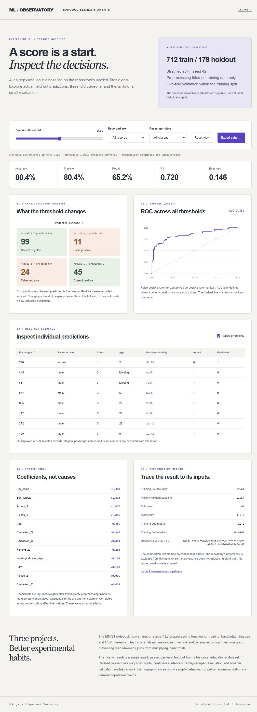

# MLProjects · Experiment Observatory

A collection of machine-learning experiments, now with a reproducible evaluation pipeline and an interactive inspection surface. The browser view uses **actual held-out predictions** from the labeled Titanic CSV already in this repository. It requires no API key or model download.



## Run the viewer

```bash
python -m http.server 49214
```

Open http://localhost:49214/lab/. Adjust the classification threshold, inspect demographic/class cohorts, examine errors, and export the selected predictions. Confusion counts, ROC AUC, precision, recall, F1 and Brier loss are computed from the same held-out records. Undefined metrics are shown as N/A. Assets and data are local; there are no runtime CDNs.

## Reproduce the experiment

Python 3.12 or 3.13, with the pinned scientific dependencies:

```bash
python -m pip install -r requirements-lab.txt
python -m ml_lab.titanic
python -m unittest discover -s tests -p "test_*.py"
npm test
```

`lab/report.json` records the canonical-LF dataset hash, dependency versions, train/holdout IDs, fitted coefficients, training medians and per-record probabilities. `TitanicPred/evaluation.ipynb` provides a notebook entry point to the same pipeline. The Node tests independently reconcile browser metrics against scikit-learn's saved results.

### Measured seed-42 baseline

| Evaluation | Result |
| --- | ---: |
| Labeled records | 891 |
| Training / untouched holdout | 712 / 179 |
| Holdout accuracy, threshold 0.50 | 80.45% |
| Holdout ROC AUC | 0.8394 |
| Five-fold accuracy within training | 79.64% mean |

The L2 logistic model uses age, fare, family size, passenger class, recorded sex and embarkation port. Median imputation, scaling and categorical encoding are fitted **inside the training pipeline**, including each validation fold. Unknown categories are handled without refitting an encoder on evaluation data. No tuning on the holdout was performed for the recorded baseline.

These are measured results for this split, not a leaderboard score or a claim about the saved neural-network model. The competition test file is unlabeled here; `answer.csv` has no verified ground-truth provenance and is excluded. The original `TitanicPred/brain.ipynb` and H5 model remain historical artifacts, with their limitations labeled.

### Repairing the other experiments

- **MNIST:** `ml_lab/images.py` provides one finite, shape-checked axis-1 L2 normalization path for training, test images, handwritten input and CSV inference. This preserves the original saved model's training convention. The notebook previously divided handwritten images by 255 and skipped normalization for CSV inference. Optional inputs now have clear missing-file states. TensorFlow training and model quality were not rerun or revalidated in this update.
- **Traffic crashes:** `ml_lab/crashes.py` validates one row per crash, vehicle unit and person, rejects orphan child records, and aggregates tables separately. It prevents a crash × vehicles × people join from multiplying injuries and preserves actual age instead of overwriting it with `2021 - AGE`. The corrected notebook distinguishes vehicle-record counts from unique crash involvement. The external archive is absent; deterministic fixtures validate the correction, not a new empirical finding.

## Interpretation and provenance

The Titanic CSV is the existing [Kaggle Titanic educational dataset](https://www.kaggle.com/competitions/titanic/data); no new passenger data was fetched. The report omits names and ticket numbers. The historical source CSV remains unchanged. The pipeline follows [scikit-learn's guidance on preprocessing leakage](https://scikit-learn.org/stable/common_pitfalls.html). MNIST normalization matches the original [TensorFlow normalize](https://www.tensorflow.org/api_docs/python/tf/keras/utils/normalize) convention (`axis=1`, L2).

This is a small historical dataset and one passenger-level holdout. Related passengers can span splits. Demographic slices can be small and do not justify population-wide or causal conclusions. The probabilities have not been separately calibrated. Exploring thresholds on the holdout is descriptive; selecting a threshold from it would require another untouched evaluation set. Confidence intervals, family-grouped evaluation and broader validation remain future work. Traffic involvement counts lack exposure denominators and cannot rank vehicle safety.
